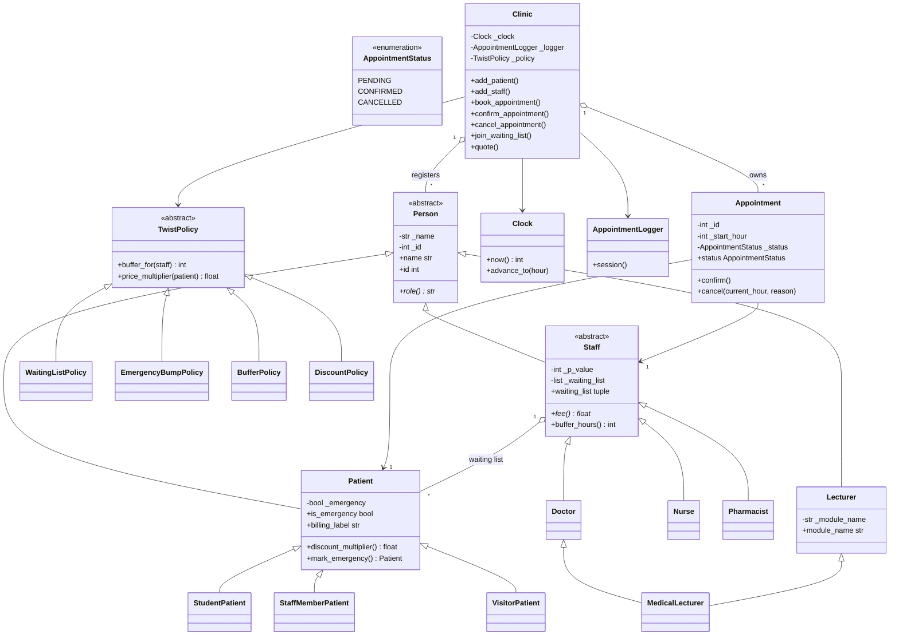
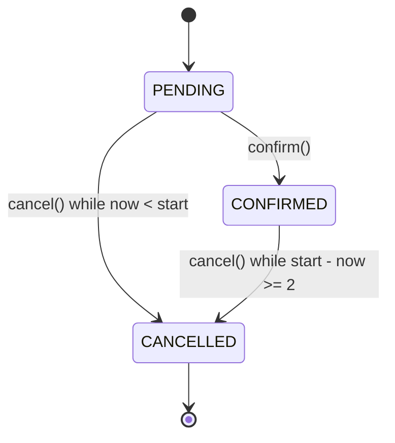

# UZ Clinic Appointment System

**University of Zimbabwe — Department of Computer Science**  
**Course:** Programming Languages  
**Programme:** BSc Honours in Computer Science (HCS)  
**Project:** Clinic Appointment System Mini Project  
**Language:** Python 3.12+ (tested on Python 3.14.4)

**Pair submission**

| Partner | Registration number | Programme |
|---|---|---|
| Super Washington Banga | R2420381 | HCS |
| Anesu Prosper Matanhire | R2420441 | HCS |

A dependency-free clinic appointment system demonstrating abstraction, encapsulation, a status state machine, pure polymorphism, context-managed logging, cooperative multiple inheritance, and all four `P mod 4` twist behaviours.

---

## Quick start

```bash
cd ~/assignments/clinic-assignment
python3 main.py
python3 -m unittest discover -s tests -v
pytest -q            # optional; the suite is unittest-compatible
```

The repository has **zero runtime dependencies**. `pytest` is optional tooling; the tests can be run entirely with the standard library.

---

## 1. Design goals and language choice

Python was chosen deliberately because two requirements map directly onto language mechanisms:

1. **Q4 — deterministic logging:** Python's context-manager protocol (`__enter__` / `__exit__`) guarantees teardown even when a domain exception is raised mid-operation.
2. **Q5 — the diamond:** Python supports multiple class inheritance and cooperative `super()` with C3 linearisation. `MedicalLecturer(Doctor, Lecturer)` has one `Person` base and initialises it exactly once.

The code also uses:

- an injected `Clock` so the wall clock is never read;
- properties and underscore-prefixed fields for encapsulation;
- `Enum` for the appointment status;
- a strategy hierarchy for the four twist policies;
- virtual methods (`fee()`, `buffer_hours()`, `discount_multiplier()`) instead of runtime type checks.

---

## 2. P, the modulo arithmetic, and the four twists

The assignment brief uses a parameter `P` but does **not** define how it is formed. This project therefore makes the assumption explicit and configurable:

```python
STUDENT_1_ID = 2420381
STUDENT_2_ID = 2420441
COMBINED_PAIR_P = 4840822
DEFAULT_P = STUDENT_1_ID
```

`DEFAULT_P` is used by `Clinic` when no `p_value` is supplied. Both partner IDs give **Twist 1 (emergency)**. The combined sum gives **Twist 2 (buffer)**. Synthetic values are used only to exercise Twists 0 and 3.

### 2.1 Verified arithmetic

The difference `2420441 - 2420381 = 60`, and `60 = LCM(3, 4, 5)`, so the two partner IDs are congruent modulo 3, 4 and 5. The actual shared residue triple is **`(mod 5, mod 3, mod 4) = (1, 2, 1)`** — not `(1, 1, 1)`.

| P source | P | P mod 5 | Doctor fee | P mod 3 | Nurse fee | P mod 4 | Active twist |
|---|---:|---:|---:|---:|---:|---:|---|
| Super | 2,420,381 | 1 | **45** | **2** | **12** | 1 | Emergency bump |
| Anesu | 2,420,441 | 1 | **45** | **2** | **12** | 1 | Emergency bump |
| Combined | 4,840,822 | 2 | **50** | **1** | **11** | 2 | Staff buffer |
| Synthetic 0 | 2,420,380 | 0 | 40 | 1 | 11 | 0 | Waiting list |
| Synthetic 3 | 2,420,383 | 3 | 55 | 1 | 11 | 3 | Patient discounts |

Worked checks:

- `3 × 806,793 = 2,420,379`, so `2,420,381 mod 3 = 2`.
- `3 × 806,813 = 2,420,439`, so `2,420,441 mod 3 = 2`.
- `3 × 1,613,607 = 4,840,821`, so `4,840,822 mod 3 = 1`.
- `2,420,380` is divisible by 5, so the first partner fee is `40 + 5×1 = 45`.
- `4,840,820` is divisible by 5 with remainder 2, so the combined doctor fee is `40 + 5×2 = 50`.

**Every test, document and demo uses `Nurse = 12` for the partner IDs and `Nurse = 11` for the combined sum.**

### 2.2 Where P is used

`P` has two independent, immutable uses:

1. **Fee calculation:** each `Staff` object freezes its `p_value` at construction (default `DEFAULT_P`). `Doctor.fee()` and `Nurse.fee()` then use that value.
2. **Twist selection:** `Clinic(clock, p_value=...)` selects the `P mod 4` policy once, at construction.

This avoids mutable global state and lets the demonstration show the combined-P fees without changing a staff member's fee after construction.

### 2.3 All four policies

| `P mod 4` | Policy | Behaviour |
|---|---|---|
| 0 | `WaitingListPolicy` | Cancelling an appointment offers the slot to the first conflict-free patient on that staff member's waiting list, as a new `PENDING` appointment. |
| 1 | `EmergencyBumpPolicy` | A flagged emergency patient may bump a `PENDING` appointment at the same staff/hour. A `CONFIRMED` appointment is never bumped. |
| 2 | `BufferPolicy` | The Clinic asks `staff.buffer_hours()` and enforces the free gap: doctors 2, nurses 1, pharmacists 0. |
| 3 | `DiscountPolicy` | The Clinic asks `patient.discount_multiplier()` and multiplies the staff fee: student 0.5, staff-member 0.0, visitor 1.0. |

Outside its active twist, a capability is dormant. This prevents e.g. buffer rules from interfering with the emergency twist, while keeping one Clinic implementation for all four policies.

---

## 3. Repository structure

```text
clinic-assignment/
├── .gitignore
├── README.md
├── pyproject.toml
├── main.py
├── src/
│   ├── __init__.py
│   ├── config.py
│   ├── clock.py
│   ├── exceptions.py
│   ├── logger.py
│   ├── policies.py
│   ├── clinic.py
│   └── models/
│       ├── __init__.py
│       ├── person.py
│       ├── patient.py
│       ├── staff.py
│       ├── lecturer.py
│       └── appointment.py
└── tests/
    ├── __init__.py
    └── test_clinic_system.py
```

The assignment PDF and all generated reports, slides and video guides live **outside** the repository. They are ignored by `.gitignore` and are not part of the submitted source tree.

---

## 4. Class diagram

### 4.1 Mermaid (renders on GitHub)



### 4.2 ASCII UML

```text
                         +----------------------+
                         |   <<abstract>>       |
                         |        Person        |
                         |----------------------|
                         | - _name : str        |
                         | - _id   : int        |
                         | + name : str         |
                         | + id   : int         |
                         | + role() : str       |
                         +----------+-----------+
                                    |
          +-------------------------+-------------------------+
          |                         |                         |
+---------+---------+     +---------+---------+     +---------+---------+
|      Patient      |     |   <<abstract>>    |     |     Lecturer      |
|-------------------|     |       Staff       |     |-------------------|
| - _emergency      |     |-------------------|     | - _module_name    |
| + discount_mult() |     | - _p_value        |     | + module_name     |
| + mark_emergency()|     | - _waiting_list   |     | + role()          |
+----+----+----+----+     | + fee()           |     +---------+---------+
     |    |    |          | + buffer_hours()  |               |
     |    |    |          | + waiting_list    |               |
     |    |    |          +----+----+----+----+               |
     |    |    |               |    |    |                    |
  +--+  +--+ +---+          +--+ +--+ +----+                 |
  |Stu|  |Stf| |Vis|          |Dr| |Nu| |Pharm|                |
  +---+  +---+ +---+          +--+ +--+ +-----+                |
                                |                              |
                                +--------------+---------------+
                                               |
                                     +---------+----------+
                                     |  MedicalLecturer   |
                                     | role() = "Doctor   |
                                     | and Lecturer"      |
                                     +--------------------+

+----------------------+        +---------------------------+
|     Appointment      |        |          Clinic           |
|----------------------|        |---------------------------|
| - _id : int          |        | - _clock : Clock          |
| - _start_hour : int  |<>------| - _logger : AppointmentLogger
| - _status : enum     |        | - _policy : TwistPolicy   |
| + confirm()          |        | - _appointments           |
| + cancel(now, reason)|        | - _patients / _staff      |
| + status             |        | + book / confirm / cancel |
+----------+-----------+        | + join_waiting_list()      |
           |                    | + quote()                  |
           |                    +-------------+-------------+
           |                                  |
           |                     +------------+------------+
           |                     |                         |
           v                     v                         v
      +---------+          +----------+              +--------------+
      | Patient |          |  Clock   |              | Appointment  |
      +---------+          +----------+              |   Logger     |
                                                     +--------------+
```

`MedicalLecturer` is a `Doctor` and a `Lecturer`; C3 produces:

```text
MedicalLecturer -> Doctor -> Staff -> Lecturer -> Person -> ABC -> object
```

---

## 5. Q1 — core domain hierarchy

**Question:** Define `Person` (abstract: name, id, abstract role()), `Patient`, `Staff` (abstract: abstract fee()), `Doctor`, `Nurse`, `Pharmacist`, `Appointment`, and `Clinic`. Include a class diagram.

Implemented:

- `Person(ABC)`: stores `_name` and `_id`, exposes read-only properties, and declares `@abstractmethod role()`.
- `Patient(Person)`: emergency capability and polymorphic billing categories.
- `Staff(Person, ABC)`: declares `@abstractmethod fee()`, provides `buffer_hours()` and the per-staff waiting list.
- `Doctor`, `Nurse`, `Pharmacist`: concrete staff roles.
- `Appointment`: one-hour booking with an `AppointmentStatus` enum.
- `Clinic`: aggregate root that owns registrations, appointments, conflicts, waiting lists and logging.
- Extra supporting classes: `Clock`, `AppointmentLogger`, `TwistPolicy` and its four strategies.

The Mermaid and ASCII diagrams above satisfy the README class-diagram requirement.

---

## 6. Q2 — encapsulation, state machine and invariants

### 6.1 Encapsulation and defensive copies

All instance state is stored in underscore-prefixed fields. Read-only properties expose values. Methods that return a collection return a fresh tuple:

- `Clinic.appointments`
- `Clinic.staff`
- `Clinic.patients`
- `Staff.waiting_list`
- `Clinic.waiting_list_for(staff)`
- `AppointmentLogger.entries`

A caller can therefore never append to, delete from, or otherwise mutate an internal list. The test suite attempts `append()` on every returned collection and verifies that the internal count is unchanged.

### 6.2 Constructor validation

`Person.__init__` rejects:

- names that are not text or are empty/whitespace-only;
- ids that are not integers or are `<= 0`.

`Appointment.__init__` rejects:

- ids that are not positive integers;
- missing patient/staff references;
- start hours outside `0..168`.

Validation uses `operator.index()` and duck-typed `.strip()` rather than `isinstance`, `type()` or `hasattr`. `ValidationError` subclasses both `ClinicError` and `ValueError`, so the built-in `ValueError` contract is satisfied.

### 6.3 Legal status transitions



| From | To | Allowed? | Rule |
|---|---|---|---|
| PENDING | CONFIRMED | Yes | `confirm()` |
| PENDING | CANCELLED | Yes, until start | `now < start`; no 2-hour notice requirement |
| CONFIRMED | CANCELLED | Yes, at least 2 hours before | `start - now >= 2` |
| CONFIRMED | PENDING | No | Illegal transition |
| CANCELLED | PENDING / CONFIRMED / CANCELLED | No | Terminal |

The exact rules enforced in `Appointment.cancel(current_hour)`:

1. `CANCELLED` is terminal — any further transition raises `InvalidTransitionError`.
2. If `current_hour >= start_hour`, cancellation is rejected with `CancellationError("too late")`.
3. If the appointment is `CONFIRMED` and `start_hour - current_hour < 2`, cancellation is rejected with `CancellationError("too late")`.
4. A `PENDING` appointment may be cancelled at one hour before start; only the confirmed appointment has the two-hour notice rule.
5. At exactly `start_hour - 2`, a confirmed cancellation is allowed.
6. At exactly `start_hour`, cancellation is rejected because the appointment has started.

### 6.4 Invariants

The formal invariant blocks are written directly above `class Appointment` and `class Clinic` in the source. They cover:

**Appointment**

- positive id; start hour in `0..168`; valid status enum;
- cancelled terminal; only three legal transitions;
- confirmed two-hour rule and started-appointment rule;
- cancellation reason set exactly when cancelled;
- stable patient/staff references.

**Clinic**

- one ID namespace for persons and appointments;
- appointments reference the exact registered objects;
- no staff double-booking and no patient double-booking at one hour;
- confirmed appointments are never bumped;
- buffer rule enforced only when the active twist is 2;
- waiting lists contain unique registered patients and offers remove a patient only after a new appointment is created;
- every public mutation uses exactly one logging session;
- the P mod 4 policy is fixed at construction.

### 6.5 Time boundary note

`Clock` accepts `0..168`. The literal rubric boundary is also accepted for `start_hour`, so an appointment may start at 168. In a strict 168-hour window, 167 would be the last start finishing at 168; this is documented in `src/config.py` and here for transparency. `Appointment.end_hour` is a derived label and may be 169 at the literal maximum.

---

## 7. Q3 — pure polymorphism for fees

Formulas:

- `Doctor.fee() = 40 + 5 × (P mod 5)`
- `Nurse.fee() = 10 + (P mod 3)`
- `Pharmacist.fee() = 5`

One loop, no type inspection:

```python
for member in clinic.staff:              # clinic.staff is a tuple[Staff, ...]
    print(f"{member.role():<12} fee = {member.fee():.2f}")
```

Example with `P = 2420381`:

```text
Doctor       fee = 45.00
Nurse        fee = 12.00
Pharmacist   fee = 5.00
```

Adding a new staff type requires only a new `Staff` subclass. `Clinic.add_staff()` accepts it, the loop calls its virtual `role()` and `fee()`, and the buffer policy calls its virtual `buffer_hours()`. The test suite adds a `Radiologist` subclass in the test file and proves that no Clinic or loop edit is needed.

**No `isinstance`, `type()`, `hasattr`, `__class__` dispatch, role-string comparison or enum type tag is used in production code or tests.**

---

## 8. Q4 — deterministic logging and error safety

`AppointmentLogger` implements the context-manager protocol. Every public Clinic mutation uses:

```python
with self._logger.session() as log:
    ...
    log.write("[log] booked #1 ...")
```

`__enter__` emits `[log] opened`; `__exit__` always emits `[log] closed` exactly once, including when the body raises. Nested sessions are rejected to prevent duplicate framing. The logger records every entry in memory before attempting to display or write it, and returns a defensive tuple from `entries`.

Example failed cancellation:

```text
[log] opened
FAILED cancel #3: too late
[log] closed
```

The failure line deliberately has no `[log]` prefix so it matches the brief's exact example. Successful action lines are prefixed with `[log]` for readability.

Every public operation logs:

- successful registrations, bookings, confirmations, cancellations, waiting-list joins, offers and bumps;
- failures before the exception is re-raised.

Example failure formats:

```text
FAILED book: staff conflict at hour 14
FAILED book: patient conflict at hour 14
FAILED book: cannot bump confirmed #3 at hour 15
FAILED cancel #3: too late
FAILED cancel #3: already cancelled
FAILED confirm #3: cancelled appointment is terminal
FAILED waitlist: patient #6001 is already on the waiting list
FAILED register: duplicate id 7000
```

### D5 behaviour

If the sink or file write fails, the domain operation is not aborted and the primary domain exception is never replaced. The logger records the entry in memory, reports the display/file failure to stderr, and closes the session. This is a **best-effort** logging policy. In an audit-critical deployment one could switch to fail-closed behaviour, but it must still never mask the primary domain exception. The test suite injects an `OSError` sink and an invalid file path to prove both guarantees.

---

## 9. Q5 — multiple inheritance and C3 linearisation

`MedicalLecturer(Doctor, Lecturer)` has the MRO:

```text
MedicalLecturer -> Doctor -> Staff -> Lecturer -> Person -> ABC -> object
```

Constructors cooperate through `super()`:

1. `MedicalLecturer.__init__` passes `name`, `id`, `module_name` and `p_value`.
2. `Doctor.__init__` consumes/forwards `p_value` and passes `module_name` through `**kwargs`.
3. `Staff.__init__` freezes `p_value`, creates the waiting list, and passes `name`, `id`, `module_name` to the next class.
4. `Lecturer.__init__` consumes `module_name` and calls `Person.__init__`.
5. `Person.__init__` runs once, validates and sets the shared state.

The proof is visible in `main.py` and tests:

```text
Person.__init__ delta: 1
instance person_init_calls: 1
```

The class also exposes a class-level `Person.init_call_count`; tests compare before/after values so unrelated instances cannot corrupt the proof.

### 9.1 What does `MedicalLecturer.fee()` return?

It inherits `Doctor.fee()` (for default P, **45.00**). A clinical appointment is charged at the medical consultation rate; the lecturer role adds teaching responsibility but does not replace the clinical fee. C3 resolves `Doctor.fee` before any `Lecturer` member because `Doctor` precedes `Lecturer` in the MRO. `Lecturer` does not define `fee()`.

### 9.2 The naive diamond bug

If `MedicalLecturer.__init__` called `Doctor.__init__(self, ...)` **and** `Lecturer.__init__(self, ...)` directly, the cooperative chain would already have reached `Person`, and the second explicit call would run `Person.__init__` again. The test suite contains a local `NaiveMedicalLecturer` demonstrating:

```text
Person.__init__ delta: 2
instance person_init_calls: 2
```

Fields would be overwritten twice and any constructor side effects would be duplicated. Cooperative `super()` plus C3 prevents this.

### 9.3 Java comparison

Java forbids multiple class inheritance. `Lecturer` would have to become an interface, for example:

```java
interface Lecturer {
    String getModuleName();
}

class MedicalLecturer extends Doctor implements Lecturer {
    private final String moduleName;   // storage must be duplicated here

    MedicalLecturer(String name, int id, String moduleName) {
        super(name, id);
        this.moduleName = moduleName;
    }

    @Override
    public String getModuleName() { return moduleName; }

    @Override
    public String role() { return "Doctor and Lecturer"; }
}
```

Java cannot inherit `moduleName` state from the interface, so the field and its accessor must be duplicated. Python inherits the single `Lecturer` state through the MRO and initialises the one `Person` exactly once.

---

## 10. Q6 — inter-object rules and all four twists

### 10.1 Core Clinic rules

- IDs are unique across **all registered persons and appointments**. `Clinic._used_ids` is one namespace. Auto-generated appointment IDs skip any ID already used by a person.
- No staff member has two non-cancelled appointments at the same hour.
- No patient has two non-cancelled appointments at the same hour, even with different staff.
- A booking or cancellation that breaks a rule fails cleanly and is logged inside exactly one `[log] opened ... [log] closed` session.
- A cancelled appointment remains in the audit history but no longer conflicts.
- Every appointment is exactly one hour; time is an injected integer hour in `0..168`.

### 10.2 Twist 0 — waiting list

`Staff` owns its `_waiting_list`. `Clinic.join_waiting_list()` validates registration and delegates to the staff member. When a cancellation occurs under `WaitingListPolicy`, `Clinic._offer_waiting_list()` scans the queue in arrival order and selects the first registered patient with:

- no active patient appointment at that hour;
- no active staff appointment at that hour;
- no buffer conflict (dormant for this policy);
- and who is not the patient who just cancelled their own slot.

The offer becomes a **new PENDING appointment** with a new clinic-unique ID; the patient is removed from the queue only after creation; the offer is logged. If nobody is eligible, the queue is left intact and the Clinic logs that fact.

### 10.3 Twist 1 — emergency bump

A patient may be flagged with `mark_emergency()`. Under `EmergencyBumpPolicy`, an emergency booking that collides with a **PENDING** appointment at the same staff/hour cancels that appointment with reason `"bumped"` and creates the new booking. A **CONFIRMED** appointment is never bumped; the booking fails and is logged. A patient conflict is validated before bumping, so an emergency cannot cancel an unrelated pending slot and then fail on the patient's own conflict. A PENDING appointment that has already started also cannot be bumped because cancellation would violate the started rule.

### 10.4 Twist 2 — buffer

`Clinic._free_gap_hours(existing_hour, new_hour)` is the single helper for this rule. A one-hour appointment at `h` occupies `[h, h+1)`. A staff member with buffer `b` requires:

```text
free_hours = later_start - (earlier_start + 1) >= b
```

So a doctor with an appointment at 10 may next start at **13** (free gap 2), not 12. The Clinic obtains `b` by calling `staff.buffer_hours()`: doctors return 2, nurses 1, pharmacists 0, and a new subclass can return its own value. No type checks are involved.

If a lecturer instead defines “2-hour gap” as start-to-start separation, the helper is the only line to change. The assignment wording “gap between appointments” is interpreted here as free time between the end of one appointment and the start of the next.

### 10.5 Twist 3 — patient discounts

`Patient.discount_multiplier()` returns the **fraction payable**, not the amount removed:

| Patient category | Multiplier | Meaning |
|---|---:|---|
| `StudentPatient` | 0.50 | pays 50% |
| `StaffMemberPatient` | 0.00 | pays 0% |
| `VisitorPatient` / base `Patient` | 1.00 | pays 100% |

Under `DiscountPolicy`, `Clinic.quote(staff, patient)` returns:

```text
staff.fee() × patient.discount_multiplier()
```

A new category such as a senior patient needs only a new `Patient` subclass with a different multiplier; the Clinic is unchanged.

### 10.6 Switching P

```python
Clinic(clock)                               # DEFAULT_P = 2420381 -> Twist 1
Clinic(clock, p_value=STUDENT_2_ID)         # 2420441          -> Twist 1
Clinic(clock, p_value=COMBINED_PAIR_P)      # 4840822          -> Twist 2
Clinic(clock, p_value=DEMO_P_TWIST_0)       # synthetic        -> Twist 0
Clinic(clock, p_value=DEMO_P_TWIST_3)       # synthetic        -> Twist 3
```

---

## 11. Q7 — design decision log (D1–D6)

### D1. Where does the 2-hour rule live?

**Decision:** it lives in `Appointment.cancel(current_hour)`. The Clinic passes `clock.now()`; the appointment owns its own start hour, status and transition logic.

**Alternatives considered**

- **Clinic:** centralises all policy in the aggregate root and makes global changes easy, but the rule leaks away from the state it protects. A caller could call `appointment.cancel()` directly and bypass the Clinic rule unless the appointment also enforced it.
- **Staff:** a doctor/nurse/pharmacist could own a role-specific notice window. This is attractive for per-role windows, but staff do not own appointment status or start hours; it would create a back-reference and blur responsibility.
- **Separate policy object:** a `CancellationPolicy` injected into `Appointment` would be the most configurable and testable in isolation. It adds indirection and another source of truth for a single global rule; it is the natural next refactor if cancellation windows become per-role.

**Trade-off:** `Appointment` gives high cohesion and cannot be bypassed. Per-role variation would require passing a notice value or policy into `cancel()`. The guide for the live change demonstrates that extension in a few lines.

Information Expert (GRASP) supports this choice: the appointment has the information needed to decide whether its own cancellation is legal.

### D2. Why is the clock design testable?

`Clock` is injected into `Clinic`. The domain never imports `time` or `datetime`; it calls `clock.now()` and `clock.advance_to(hour)`. Tests can jump directly to:

- `start - 3` (allow),
- `start - 2` (allow for confirmed),
- `start - 1` (reject for confirmed, allow for pending),
- `start` (reject: started),
- `168` (week boundary),
- and any other boundary, instantly and deterministically.

If the code called `time.time()` or `datetime.now()` directly, tests would have to sleep for hours/days, would be flaky around clock changes, and could not reliably reproduce the exact two-hour and started boundaries. The wall clock would also make the demo non-deterministic.

### D3. When Pharmacist was added, what changed besides the new class?

**Nothing in production code.** `Pharmacist(Staff)` implements `role()` and `fee()`; it inherits the default `buffer_hours() == 0`. `Clinic.add_staff()` already accepts any `Staff`, and the Q3 loop already calls virtual methods. No `Clinic`, loop, branch or registry needed editing. The only additional edits were demo/test registration and documentation. The test suite proves the stronger version by adding a `Radiologist` subclass inside the tests with a custom fee and buffer; the Clinic handles it unchanged.

### D4. What should `MedicalLecturer.fee()` return, and what stops double initialisation?

It returns `Doctor.fee()` (45.00 with default P). Clinical work is charged at the medical consultation rate. MRO resolves `Doctor.fee` before any `Lecturer` member because `Doctor` precedes `Lecturer`.

**Mechanism:** Python's C3 linearisation plus cooperative `super()`. Each class consumes its arguments and forwards the rest, so the chain reaches `Person` exactly once:

```text
MedicalLecturer -> Doctor -> Staff -> Lecturer -> Person -> ABC -> object
```

Without cooperative `super()`, a naive implementation would call `Doctor.__init__` and `Lecturer.__init__` separately. The `Doctor` chain would already have run `Person.__init__`, and the explicit `Lecturer` call would run it again — the test-only `NaiveMedicalLecturer` shows `Person.__init__` delta 2. This would duplicate constructor side effects, overwrite the name/id a second time, and could create inconsistent fields in a more complex hierarchy.

### D5. What should happen if writing to or closing the log fails?

**Decision:** logging is best-effort and must never corrupt or mask the domain operation.

- The logger records the entry in memory first, then attempts the sink and optional file.
- `OSError`/display failures are caught and reported to stderr.
- `__exit__` always attempts `[log] closed` once and returns `False`, so the primary domain exception continues to propagate.
- A log-file failure does not roll back a successful booking or cancellation.
- A broken sink is tested with a simulated disk failure; a failed log-file path is tested with a directory path.

Trade-off: an audit-critical system might prefer fail-closed behaviour (refuse the operation if the audit log cannot be written). That is a policy choice, but even then the logger must not replace the domain exception with a logging exception. The current implementation favours availability and clean domain errors; this is documented rather than hidden.

### D6. Twist-specific design answers

**(0) Who owns the waiting list, and why?**  
`Staff` owns its own `_waiting_list`, because the queue is per-staff and the staff member is the natural Information Expert for demand for its own time. The Clinic coordinates registration, conflict checks and offers because only the Clinic sees all appointments and owns the transaction log. Owning the queue in `Clinic` would bloat the aggregate; owning it in `Patient` would fragment per-staff order.

**(1) Why can't a confirmed appointment be bumped?**  
Confirmation is a domain contract: the patient and staff have committed to that slot. Allowing an emergency to displace it would violate trust and make confirmation meaningless. Emergency privilege is therefore deliberately limited to `PENDING` (provisional) bookings. The Clinic checks the status before cancelling and logs the failed attempt.

**(2) Why `buffer_hours()` and not a type check?**  
The staff member knows its own clinical scheduling needs. A virtual method keeps the knowledge with the class that owns it, satisfies Open/Closed, and means a new `Radiologist`/`Physiotherapist` can declare a different buffer without editing the Clinic. A type check would require the Clinic to know every staff class and would leak new roles into central scheduling code. The Clinic only asks `staff.buffer_hours()`.

**(3) Where does the discount live, and why?**  
On `Patient`, as the polymorphic `discount_multiplier()`. It is a property of the patient category, not of the staff member's professional fee. The Clinic composes the two independent pieces:

```text
price = staff.fee() * patient.discount_multiplier()
```

`Staff` does not need to know patient billing categories, and `Patient` does not need to know staff fees. This is single responsibility and Open/Closed: a senior category is a new `Patient` subclass, with no Clinic edit.

---

## 12. Q8 — five-minute demo and live-change readiness

`main.py` is the deterministic demo. It prints both partners' names and registration numbers, then covers:

1. Q1/Q2 hierarchy, encapsulation, defensive-copy proof, constructor validation and the state machine.
2. Q3 one polymorphic staff loop: Doctor 45.00, Nurse **12.00**, Pharmacist 5.00.
3. Q4 `[log] opened` / `[log] closed`, the deliberate `FAILED cancel #3: too late`, and a duplicate-booking failure.
4. Q5 `MedicalLecturer` role, module, fee, buffer, MRO and `Person.__init__` delta 1.
5. Q6 Twist 1 emergency bump and confirmed-bump refusal.
6. Q6 Twist 2 buffer boundaries using the combined P.
7. Q6 Twist 0 waiting-list offer using synthetic P.
8. Q6 Twist 3 student/staff-member/visitor pricing using synthetic P.

The companion parent-directory video guides contain the minute-by-minute script, architecture defence and six rehearsed live changes. The most likely live changes are:

- add a `Radiologist`/`Physiotherapist` with a custom fee and buffer;
- add `NO_SHOW` status and transitions;
- change cancellation notice per staff role;
- add a daily appointment cap;
- add a recurring series within the one-week horizon;
- add a senior-patient discount category.

---

## 13. Testing

```bash
python3 -m unittest discover -s tests -v
pytest -q
```

The suite contains **80 tests** and covers:

- clock bounds, forward-only movement and deterministic boundaries;
- constructor validation for names, ids, hours, modules and P;
- defensive copies of every exposed collection;
- all legal and illegal status transitions;
- the exact `start-3` / `start-2` / `start-1` / `start` cancellation boundaries;
- the exact failure format `FAILED cancel #3: too late`;
- logging success/failure framing, nested-session rejection and broken sink/file handling;
- unique IDs across persons and appointments, staff double-booking and patient double-booking;
- all four `P mod 4` policies, including dormant behaviour outside the active policy;
- waiting-list offers, conflicts and queue preservation;
- buffer boundaries for doctors, nurses, pharmacists and a custom subclass;
- discount multipliers and custom patient categories;
- C3 MRO, one-time `Person.__init__`, and a naive double-initialisation demonstration.

The code is intentionally free of `isinstance`, `type()`, `hasattr`, `__class__` dispatch and role-string comparisons in production and tests. `src/` and `main.py` contain no `time` or `datetime` imports.

---

## 14. Limitations and deliberate choices

- **P is not defined by the brief.** The pair registration assumption is documented and configurable; all four policies are covered so any reasonable P definition still has a correct active behaviour.
- **Buffer interpretation.** The implementation uses free time after the one-hour appointment (`[h, h+1)` + buffer). The single `_free_gap_hours` helper is the only place to change if start-to-start separation is required.
- **Literal 168 start boundary.** `start_hour = 168` is accepted for rubric compatibility; the derived end label is 169. A strict week would use 167 as the last start.
- **No persistence, authentication, UI, concurrency or real calendar integration.** This is a deterministic domain-model mini project, not a production booking service.
- **Booking in the past/current hour is not prohibited** because the brief only restricts cancellation. A production system would add a booking-time policy; adding it here would be an extra rule not requested by the brief.
- **Waiting lists exist in every Clinic**, but automatic offers only occur under Twist 0; this keeps the policy gating explicit and prevents dormant features from changing other twists.

---

## 15. Repository hygiene

- The assignment PDF and all generated deliverables are outside the repository and ignored by `.gitignore`.
- The repository contains only source, tests, README, `pyproject.toml` and `.gitignore`.
- No generated virtual environment, caches, PDF, PPTX or document-generator script is tracked.
- Tests use only the Python standard library; `pyproject.toml` declares no runtime dependencies.
